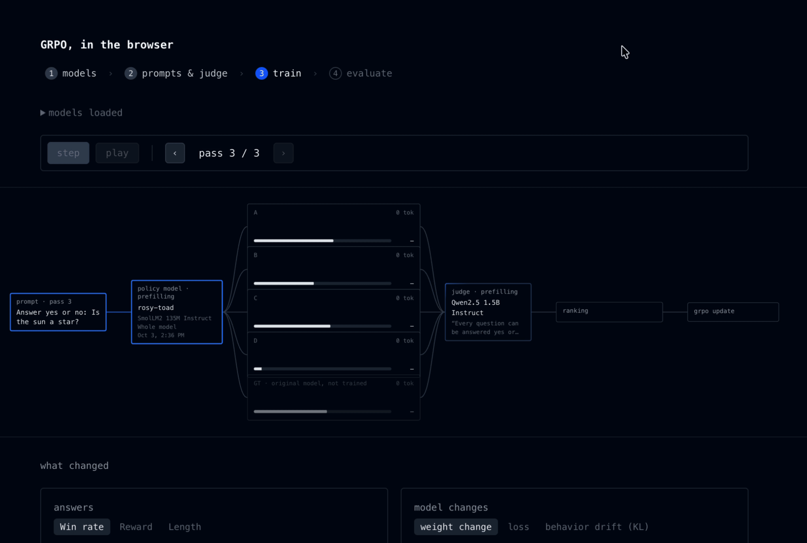

Language model RL fine-tuning, completely in the browser. 

This repo:

- downloads a small model (SmolLM2 360M by default) and a slightly larger "judge" model (Qwen3 1.7B by default)
- lets you set "questions" to ask the model and a "judge prompt"
- generates five answers from the small model (w/ KV cache pre-fill for efficiency), and then reads the judge's Yes/No logits for each one (a la Jev) to score it, or optionally its A/B logits to compare them in pairs
- uses GRPO to update the weights (either all of them or just a LoRa) of the model
- adds an evaluation interface, both to see how the fine tuning passes go and to actually run inference on the base vs. fine-tuned model

This whole package is built on Eric Zhang's excellent [jax-js](https://github.com/ekzhang/jax-js) alongside [PGlite](https://github.com/electric-sql/pglite) for state and OPFS for model weights. I made heavy use of Claude Opus 5.5 to spin this up.
